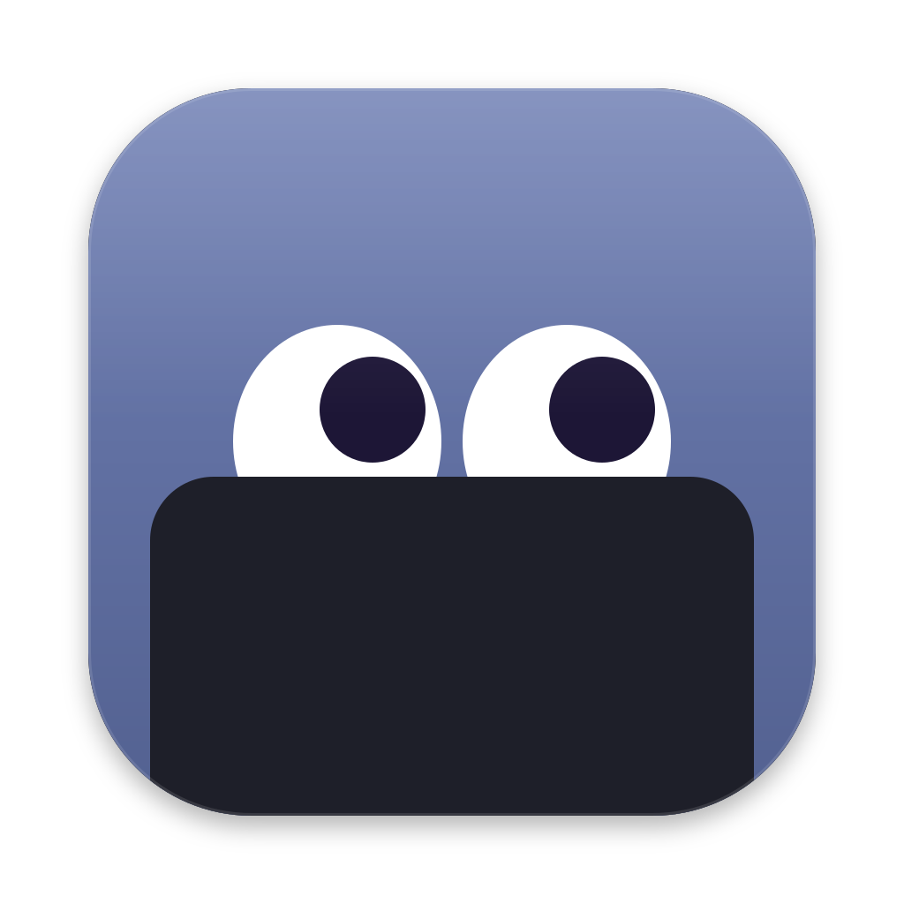
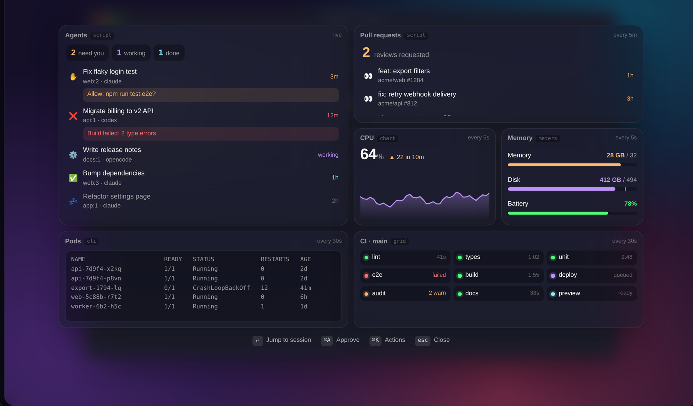

<p align="center">
  
</p>

<h1 align="center">Hold fn. See everything.</h1>

<p align="center">
  A glanceable, scriptable dashboard for your Mac. Anything you can script becomes a panel, and it disappears when you let go.
</p>

<p align="center">
  
  
  
</p>

<p align="center">
  <a href="https://tjuvkik.banjoanton.com"><b>Website</b></a> ·
  <a href="docs/install.md"><b>Install</b></a> ·
  <a href="docs/panels.md"><b>Panels</b></a> ·
  <a href="docs/README.md"><b>Docs</b></a>
</p>

<p align="center"></p>
<p align="center"><i>The glance: hold fn and your board opens over whatever you're doing. Let go and it's gone.</i></p>

## Highlights

- 👀 Hold fn to glance, let go to close. It never takes focus from your terminal and opens over every Space and full-screen app.
- 🧩 Anything you can script is a panel: a `panel.jsonc` and a short shell script next to it.
- 🔎 Rather search than look? `"view": "spotlight"` swaps the board for a list of every panel's rows, with a search field and a preview of the picked row.
- 🖱️ Act on what you see: click a row or press ⌘K to approve a PR, check out a branch or jump to a session.
- 🤖 Pipe your coding agents in and get a notification when one needs you.
- 🔧 Your agent can build panels: `tjuvkik new`, `run`, `preview` and `validate`, with JSON Schema for every file.
- 📁 Config as code: one folder in `~/.config/tjuvkik/`, reloads on save, easy to keep in your dotfiles.
- 🎨 Themes with your own colors, blur and corner radius.
- 🪶 Native Swift with no dependencies and no Dock icon. It pauses when the Mac is locked or on Low Power.

## Getting started

You need macOS 15 or later and [Homebrew](https://brew.sh):

```sh
brew install --cask banjo/tap/tjuvkik
open -a Tjuvkik          # Start it. It lives in the menu bar.
```

Or hand it to your agent. Paste this into Claude Code, Codex or whatever you use:

```text
Install Tjuvkik, a glanceable dashboard for macOS, and get it running on this Mac:

1. Check that it runs macOS 15 or later on Apple silicon, and that Homebrew is installed.
2. Run `brew install --cask banjo/tap/tjuvkik`.
3. Tjuvkik isn't notarized. The cask clears the quarantine flag, but if macOS still says it can't be opened, run `xattr -dr com.apple.quarantine /Applications/Tjuvkik.app`.
4. Start it with `open -a Tjuvkik`. Then tell me to turn on Input Monitoring for Tjuvkik in System Settings → Privacy & Security, and to set "Press 🌐 key to" to "Do nothing" in System Settings → Keyboard.
5. Run `tjuvkik validate` to check the config in ~/.config/tjuvkik/.
```

> [!IMPORTANT]
> Tjuvkik isn't notarized by Apple, so macOS may refuse to open it the first time. Allow it in System Settings → Privacy & Security ("Open Anyway"), or clear the flag yourself:
>
> ```sh
> xattr -dr com.apple.quarantine /Applications/Tjuvkik.app
> ```

A short setup then picks your trigger, [starter panels](starters/panels) and theme. Turn on Input Monitoring when asked, then hold fn. No fn key? Pick right ⌥, right ⌘ or a shortcut like ⌃⌥Space as the [trigger](docs/config.md#trigger).

## Documentation

- [Install](docs/install.md): Homebrew, first start, permissions, the 🌐 key.
- [Config](docs/config.md): `config.jsonc`, trigger, board or Spotlight, and which panels to show.
- [Panels](docs/panels.md): a command that fills a tile.
- [Script output](docs/script-output.md): the JSON a script panel prints.
- [Themes](docs/themes.md): colors, blur and corner radius.
- [Sync and share](docs/sync.md): keep your config in dotfiles, export and import.
- [Command line](docs/cli.md): the `tjuvkik` command.

## Development

```sh
scripts/create-cert.sh    # Once, to make a signing certificate.
scripts/bundle.sh --open  # Build, install and start.
swift test                # Run the tests.
```

See [internal/building.md](internal/building.md).

## Why the name?

*Tjuvkik* is Swedish for a sneak peek.
