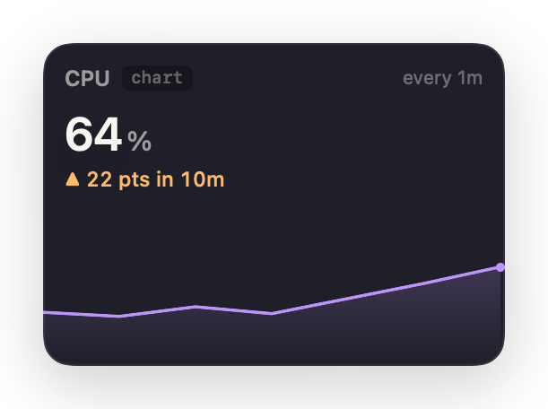
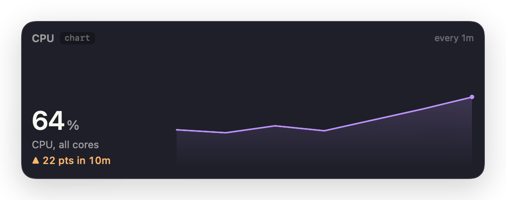
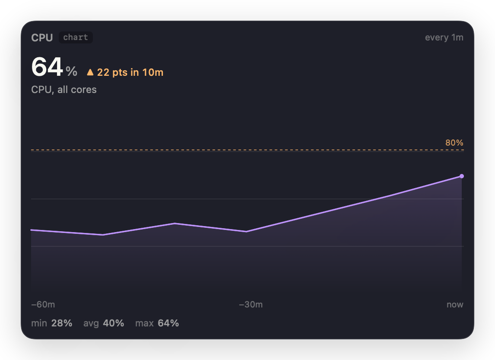

# Chart

One number and where it's heading.

```json
{
  "chart": {
    "value": "64", "unit": "%", "label": "CPU, all cores",
    "delta": { "text": "▲ 22 pts in 10m", "tone": "warning" },
    "series": [31, 28, 35, 30, 41, 52, 64],
    "min": 0, "max": 100, "threshold": 80,
    "axis": ["−60m", "−30m", "now"],
    "tone": "accent"
  }
}
```

  

| Size | Shows |
|---|---|
| `s` | The value and change, a sparkline below them. |
| `m` | The value, label and change on the left, the chart on the right. |
| `l`, `xl` | The value and change, the label, the chart with a grid and the threshold line, the axis labels, then min, avg and max. |

## Fields

| Field | |
|---|---|
| `value` | The current value, as shown: `64`, `"4:12"`. Text or a number. Without it, the last value in `series`. |
| `unit` | Smaller, after the value: `%`, `ms`, `GB`. |
| `label` | What the number is, like `CPU, all cores`. Shown at `m` and `l`. |
| `delta` | The change: `{ "text": "▲ 22 pts in 10m", "tone": "warning" }`, or just the text. Your script picks the tone, since up isn't always good. |
| `series` | Numbers, oldest first. Numbers written as text work; `null` is skipped. |
| `min`, `max` | The bottom and top of the scale. Without them, the series' lowest and highest value. |
| `threshold` | A dashed line at this value, with its label, at `l`. |
| `axis` | Labels under the chart at `l`, spread from left to right: `["−60m", "−30m", "now"]`. |
| `tone` | The line's color: `accent` (default), `info`, `success`, `warning`, `error`, `muted`. |

Either `value` or `series` is required. min, avg and max use the value's decimals and its unit: with `"value": "0.4"` and `"unit": "%"`, an average of 0.125 shows as `0.1%`.

`summary` and `menuBar` work as for [rows](../script-output.md#menu-bar): they set what the menu bar shows.

## Let Tjuvkik keep the series

A script that prints only the current value can leave the series to Tjuvkik. Set `history` in [panel.jsonc](../panels.md) to how many values to keep, from 2 to 1000:

```jsonc
{
  "type": "chart",
  "command": "./cpu.sh",
  "every": "1m",
  "history": 60
}
```

Each run adds its `value` to the series, and the oldest drops off once there are 60. It only works when `value` is a number and the script prints no `series` of its own. The series starts over when Tjuvkik restarts or the panel's command changes.

## Example

CPU use on a Mac, one value a minute, with the last hour kept by `"history": 60`:

```sh
#!/bin/sh
idle=$(top -l 2 -n 0 -s 1 | awk '/CPU usage/ { idle = $7 } END { sub("%", "", idle); print idle }')
used=$(echo "100 - $idle" | bc | cut -d. -f1)
tone=accent
[ "$used" -ge 80 ] && tone=warning
cat <<EOF
{ "chart": {
  "value": $used, "unit": "%", "label": "All cores, last hour",
  "min": 0, "max": 100, "threshold": 80, "axis": ["−60m", "−30m", "now"], "tone": "$tone"
} }
EOF
```

With `"type": "chart"` in [panel.jsonc](../panels.md), the tile always reads the output as a chart, and says what's missing when the script prints something else.
