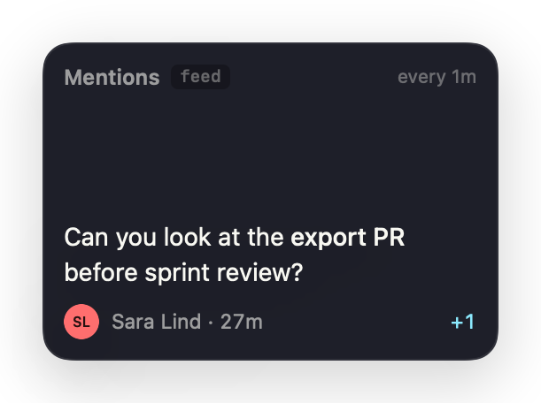
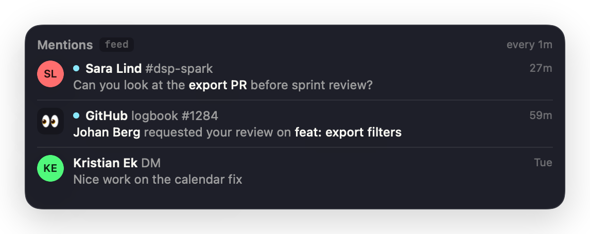
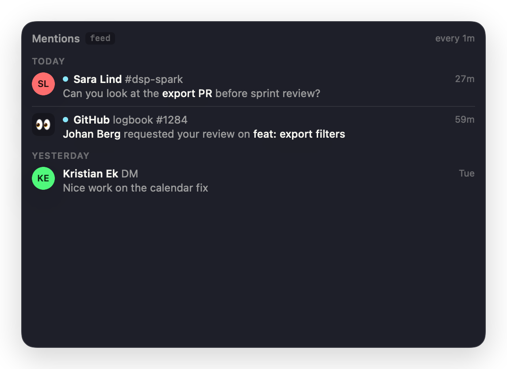

# Feed

Who said what, and when: mentions, notifications, commits, posts.

```json
{
  "items": [
    { "author": "Sara Lind", "where": "#dsp-spark", "text": "Can you look at the **export PR** before sprint review?", "time": "2026-11-16T13:12:00Z", "unread": true, "url": "slack://channel?team=T1&id=C1" },
    { "author": "GitHub", "icon": "👀", "where": "logbook #1284", "text": "**Johan Berg** requested your review on **feat: export filters**", "time": "2026-11-16T12:40:00Z", "unread": true },
    { "author": "Kristian Ek", "avatar": "https://example.com/kristian.png", "where": "DM", "text": "Nice work on the calendar fix", "time": "2026-11-15T16:05:00Z" }
  ]
}
```

  

| Size | Shows |
|---|---|
| `s` | The newest message, large, with who and when under it, and how many more are unread. |
| `m` | The latest messages that fit, two lines each. |
| `l`, `xl` | The messages that fit, under a heading per day: Today, Yesterday, the weekday, then the date. |

## Fields

Each item:

| Field | |
|---|---|
| `text` | Required. The message. `**bold**` is drawn brighter, for names and titles. |
| `author` | Who said it. Without `avatar` or `icon`, the tile draws their initials on a color picked from the name, the same every time. |
| `avatar` | An image URL, drawn round. The initials show while it loads, and if it can't. |
| `icon` | An emoji drawn in a square instead, for bots and services: `🤖`, `❌`. |
| `where` | Where it was said, after the author: `#dsp-spark`, `DM`, `logbook #1284`. |
| `time` | When it was said. ISO 8601 (`2026-11-16T13:12:00Z`, or `2026-11-16T14:12` in your time zone) or a Unix timestamp. Shown relative: `now`, `5m`, `2h`, `Sun` within the week, `12 Nov`. Anything else is shown as is. |
| `unread` | `true` puts a dot before the author. |
| `url` | Opened when the item is clicked in the glance. Closes the glance. |

When every item has a `time`, the tile shows the newest first; otherwise it keeps your order. Relative times update every minute between runs.

`items` can also be a single item instead of an array. Items with `author` or `text` make a feed; items with `title` make a checklist.

`summary` and `menuBar` work as for [rows](../script-output.md#menu-bar): they set what the menu bar shows.

## Example

Your unread GitHub notifications, with [gh](https://cli.github.com) and [jq](https://jqlang.org):

```sh
#!/bin/sh
gh api notifications --jq '{ items: [ .[] | {
  author: .repository.owner.login,
  where: .repository.name,
  text: "**\(.subject.type)** \(.subject.title)",
  time: .updated_at,
  unread: .unread
} ] }'
```

With `"type": "feed"` in [panel.jsonc](../panels.md), the tile always reads the output as a feed, and says what's missing when the script prints something else.
