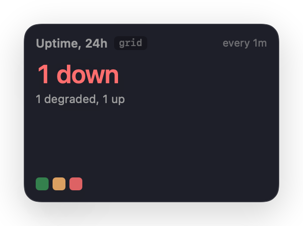
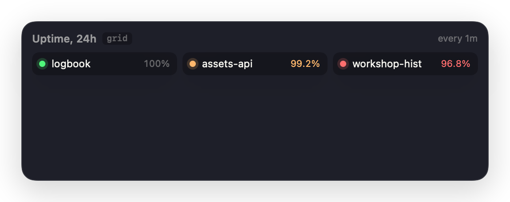
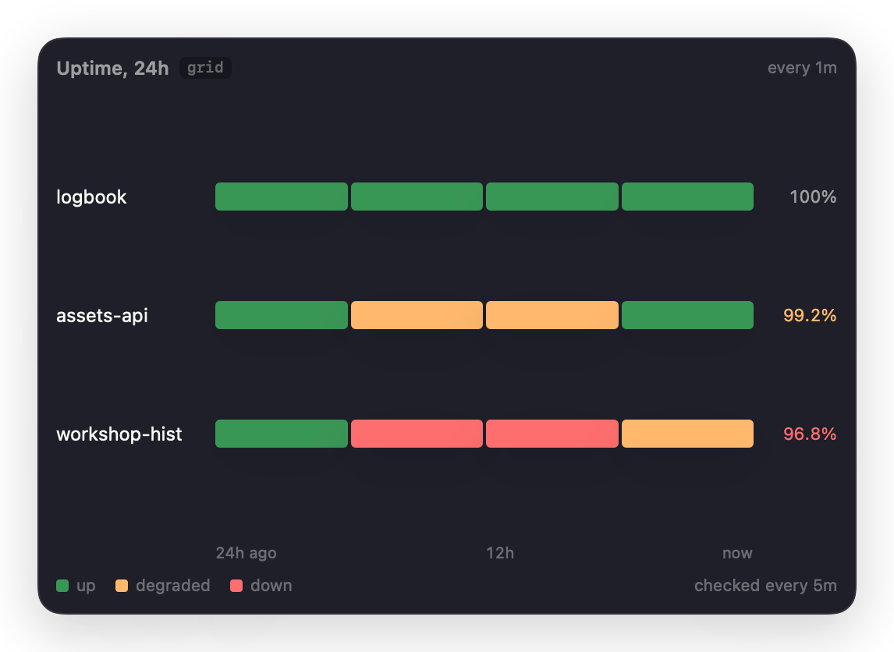

# Grid

Many things at once, a colored cell each: services, CI jobs, pull requests, uptime.

```json
{
  "grid": {
    "rows": [
      { "label": "logbook", "value": "100%", "cells": ["success", "success", "success", "success"] },
      { "label": "assets-api", "value": "99.2%", "tone": "warning", "cells": ["success", "warning", "warning", "success"] },
      { "label": "workshop-hist", "value": "96.8%", "tone": "error", "cells": ["success", "error", "error", "warning"] }
    ],
    "axis": ["24h ago", "12h", "now"],
    "legend": { "success": "up", "warning": "degraded", "error": "down" },
    "footer": "checked every 5m"
  }
}
```

  

| Size | Shows |
|---|---|
| `s` | The worst count, like `1 down`, the rest below it (`1 degraded, 10 up`), then a dot per row. |
| `m` | A chip per row, three to a line: dot, label, value. |
| `l`, `xl` | A row per item, its cells as history, the value on the right. The axis, legend and footer below. |

Rows that don't fit are left out.

## Fields

`grid`:

| Field | |
|---|---|
| `rows` | Required, unless you give `levels`. |
| `axis` | Labels under the cells at l, spread out evenly: `["24h ago", "12h", "now"]`. |
| `legend` | What each tone means, as an object from tone to text: `{ "error": "down" }`. Shown at l, mildest first, and used for the words at s. |
| `footer` | A line at the bottom at l, and under a heatmap at m: `checked every 5m`. |
| `value`, `label` | Replace the computed text at s, like `All live` and `dev, qa, prod in sync`. |
| `tone` | The color of `value` at s, and of the heatmap (accent by default). |
| `levels` | A heatmap instead of rows. See [Heatmap](#heatmap). |
| `height` | Cells per heatmap column for a flat `levels` list. Default `7`. |

Each row:

| Field | |
|---|---|
| `label` | Required. Text or a number. |
| `value` | Right of the cells at l, in the chip at m: `99.2%`, `failed`, `2:48`. |
| `tone` | The row's state: its dot at s and m, and its value's color. Without one, the last tone in `cells`. |
| `cells` | The row's history, oldest first, shown at l. Each cell is a tone, or a level from 0 to 4. `null` is an empty cell. |

`rows` can also be a single row instead of an array.

### Worst first

A row's state is its `tone`, else its last tone cell. At s, the worst state counts first, in this order: `error`, `warning`, `info` and `accent`, `success`, then `muted` and `normal`. When every row is `success`, it reads `All up`, with `up` from the legend. Without a legend, tones read as plain words: `error`, `warning`, `ok`.

### Heatmap

Give `levels` instead of `rows` for a heatmap, like GitHub contributions. Each level is 0 to 4; numbers outside are clamped, and fractions rounded. Either a flat list, oldest first, filled into columns of `height` from the top:

```json
{ "grid": { "levels": [0, 1, 3, 4, 2, 0, 0, 1, 2], "footer": "214 commits in 20 weeks" } }
```

or a list of columns:

```json
{ "grid": { "levels": [[0, 1, 3, 4, 2, 0, 0], [1, 2]] } }
```

Every size shows the newest columns that fit; m and l add the footer and a less-to-more key. A row's `cells` can be levels too, for a heatmap per row at l.

`summary` and `menuBar` work as for [rows](../script-output.md#menu-bar): they set what the menu bar shows.

## Example

The last runs of each workflow in a repository, with [gh](https://cli.github.com) and [jq](https://jqlang.org):

```sh
#!/bin/sh
gh run list --repo acme/app --limit 100 --json workflowName,conclusion,status | jq '
  def tone: if .status != "completed" then "accent"
    elif .conclusion == "success" then "success"
    elif .conclusion == "failure" then "error" else "warning" end;
  { grid: {
      rows: (group_by(.workflowName) | map({
        label: .[0].workflowName,
        tone: (.[0] | tone),
        value: (.[0].conclusion // .[0].status),
        cells: (.[:12] | reverse | map(tone))
      })),
      axis: ["older", "latest"],
      legend: { success: "passing", warning: "cancelled", error: "failing", accent: "running" }
  } }'
```

`gh run list` prints the newest run first, so each row's first run is its state, and `reverse` puts the cells oldest first.

With `"type": "grid"` in [panel.jsonc](../panels.md), the tile always reads the output as a grid, and says what's missing when the script prints something else.
