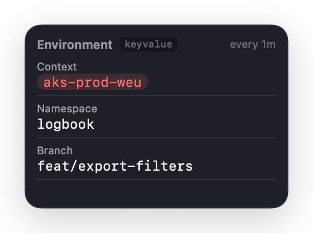
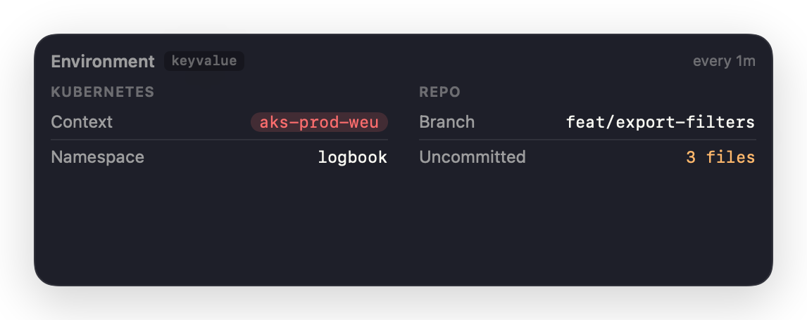
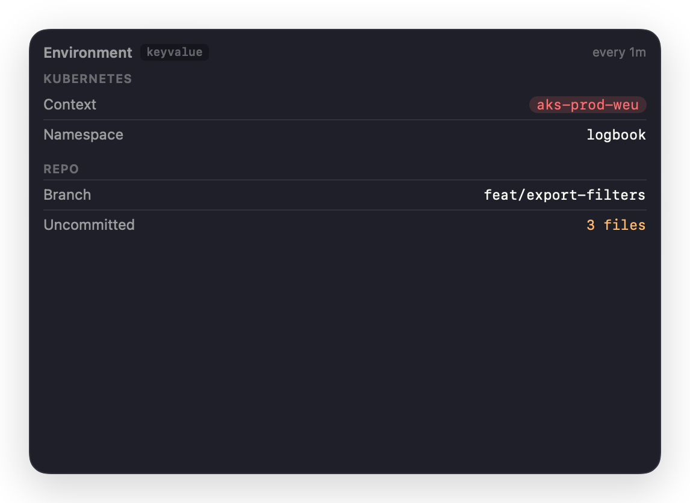

# Key-value

Exact facts, grouped: a label on the left, its value on the right.

```json
{
  "pairs": [
    { "section": "Kubernetes" },
    { "key": "Context", "value": "aks-prod-weu", "tone": "error", "pill": true },
    { "key": "Namespace", "value": "logbook" },
    { "section": "Repo" },
    { "key": "Branch", "value": "feat/export-filters" },
    { "key": "Uncommitted", "value": "3 files", "tone": "warning" }
  ]
}
```

  

| Size | Shows |
|---|---|
| A single cell, 1×1 | Label above value, for the first pairs that fit. No headings. |
| One row high, like 2×1 or 4×1 | Two columns of pairs, the left one filled first. |
| Taller, like 2×2 or 1×3 | One list, with section headings. |

Values are monospaced and cut in the middle when they don't fit, so the ends of IDs and paths stay visible. Pairs that don't fit are left out, never shown half.

## Fields

Each item in `pairs` is a heading or a pair.

A heading:

| Field | |
|---|---|
| `section` | Required. Shown above the pairs after it, until the next heading. |

A pair:

| Field | |
|---|---|
| `key` | Required. The label. |
| `value` | Required. Text, a number or `true`/`false`. |
| `tone` | The value's color. |
| `pill` | `true` draws the value on a capsule tinted in its tone. Needs a `tone`. |

`pairs` can also be a single pair instead of an array. A heading with no pairs after it isn't shown. One row high, a section split between the columns goes on in the right one without its heading again.

`summary` and `menuBar` work as for [rows](../script-output.md#menu-bar): they set what the menu bar shows.

## Example

Where your shell points, with [kubectl](https://kubernetes.io/docs/reference/kubectl/), [jq](https://jqlang.github.io/jq/) and git:

```sh
#!/bin/sh
context=$(kubectl config current-context)
namespace=$(kubectl config view --minify --output 'jsonpath={..namespace}')
cd ~/code/logbook || exit 1
branch=$(git branch --show-current)
changed=$(git status --porcelain | wc -l | tr -d ' ')
tone=normal; [ "$changed" -gt 0 ] && tone=warning
prod=normal; case $context in *prod*) prod=error ;; esac
jq -n --arg context "$context" --arg namespace "${namespace:-default}" --arg branch "$branch" \
  --argjson changed "$changed" --arg tone "$tone" --arg prod "$prod" '{ pairs: [
  { section: "Kubernetes" },
  { key: "Context", value: $context, tone: $prod, pill: true },
  { key: "Namespace", value: $namespace },
  { section: "Repo" },
  { key: "Branch", value: $branch },
  { key: "Uncommitted", value: "\($changed) files", tone: $tone }
] }'
```

With `"type": "keyvalue"` in [panel.jsonc](../panels.md), the tile always reads the output as key-value, and says what's missing when the script prints something else.
