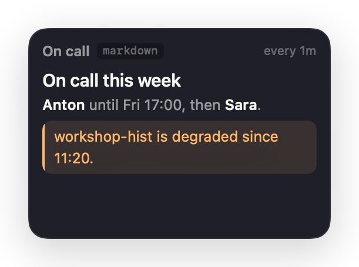
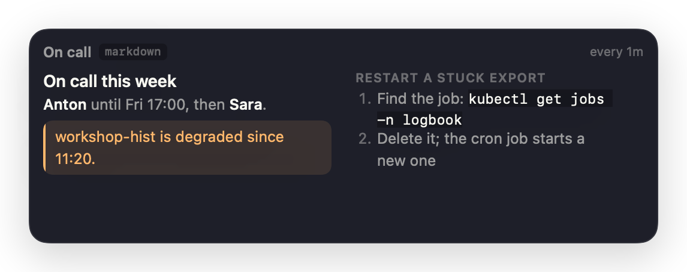
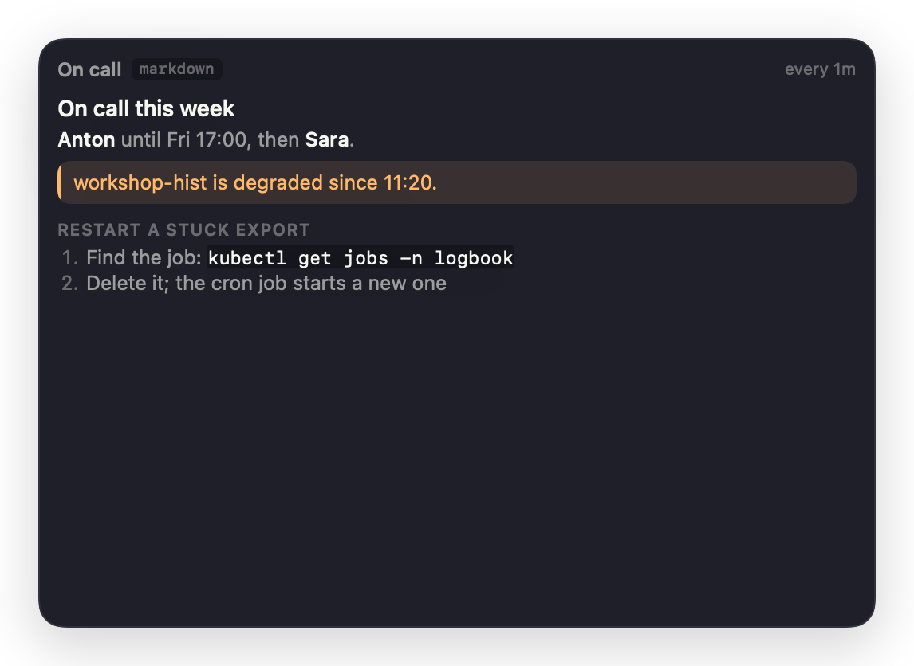

# Markdown

Notes, runbooks and answers, written in Markdown.

```json
{
  "markdown": "### On call this week\n**Anton** until Fri 17:00, then **Sara**.\n\n> workshop-hist is degraded since 11:20.\n\n#### Restart a stuck export\n1. Find the job: `kubectl get jobs -n logbook`\n2. Delete it; the cron job starts a new one"
}
```

  

| Size | Shows |
|---|---|
| `s` | The heading and the first lines. Paragraphs stop after four lines. |
| `m` | The document in two columns. |
| `l`, `xl` | The whole document, cut where the tile ends. |

Only whole blocks are shown: a paragraph, list item or code block that doesn't fit is left out, with everything after it.

## Fields

| Field | |
|---|---|
| `markdown` | Required. The text, or an array of lines. |

`summary` and `menuBar` work as for [rows](../script-output.md#menu-bar): they set what the menu bar shows.

## What's supported

A subset of [CommonMark](https://commonmark.org):

| Markdown | Drawn as |
|---|---|
| `#`, `##`, `###` | A title. The highest of these in the document is the title; deeper ones are section labels. |
| `####` to `######` | A small, uppercase section label. |
| `**bold**`, `*italic*`, `~~strike~~` | As written. |
| `` `code` `` | Monospaced, on a darker background. |
| `[text](https://…)` | A link, in the info color. |
| `-`, `*`, `+`, `1.` | Lists. Indent by two spaces or more to nest them, up to four levels. |
| `- [ ]`, `- [x]` | A task, open or done. |
| ```` ``` ```` or `~~~` | A code block, one line per line, cut at the tile's edge. |
| `> ` | A note in the warning tone. |
| `---`, `***`, `___` | A line across. |

Not supported, so shown as text: headings underlined with `===` or `---`, code indented by four spaces, HTML, tables and images.

## A file instead of a script

A markdown panel can read a file instead of running a command. The tile reloads when the file changes:

```jsonc
{ "type": "markdown", "title": "Today", "file": "~/notes/today.md", "size": "l" }
```

`file` takes `~`, an absolute path, or a path in the panel's folder. Use either `file` or `command`, not both. See [panels](../panels.md).

## Example

Today's section of a daily note, as written in Obsidian:

```sh
#!/bin/sh
note="$HOME/notes/daily/$(date +%F).md"
[ -f "$note" ] || { echo '{ "markdown": "_No note yet._" }'; exit 0; }
jq -Rs '{ markdown: . }' "$note"
```

With `"type": "markdown"` in [panel.jsonc](../panels.md), the tile always reads the output as markdown, and says what's missing when the script prints something else.
