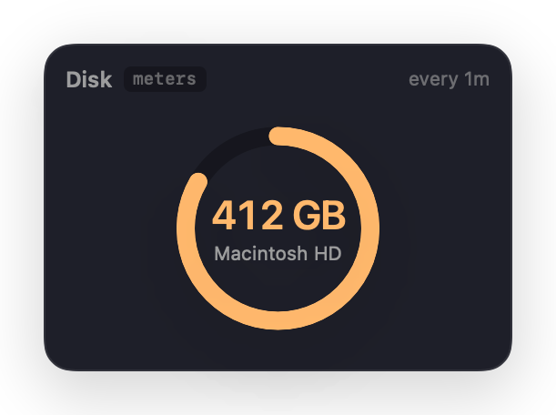
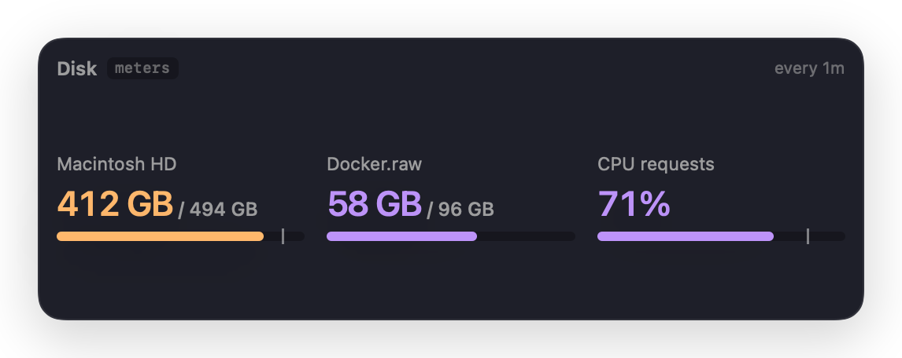
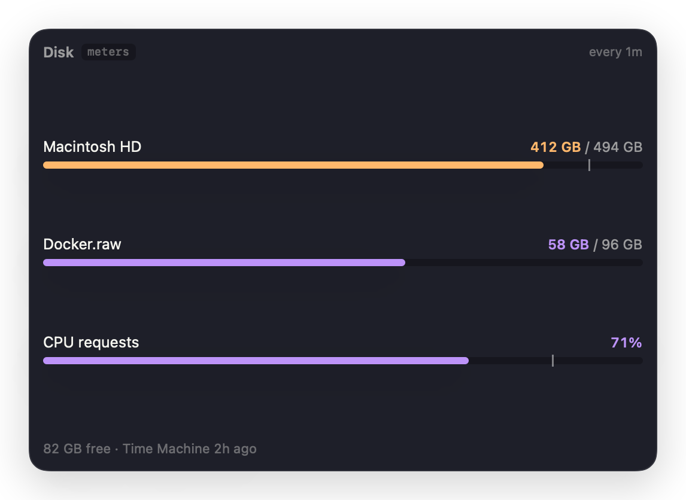

# Meters

How full, how far, how close to a limit.

```json
{
  "meters": [
    { "label": "Macintosh HD", "value": 412, "max": 494, "text": "412 GB", "of": "494 GB", "mark": 450, "tone": "warning" },
    { "label": "Docker.raw", "value": 58, "max": 96, "text": "58 GB", "of": "96 GB" },
    { "label": "CPU requests", "value": 71, "mark": 85 }
  ],
  "footer": "82 GB free · Time Machine 2h ago"
}
```

  

| Size | Shows |
|---|---|
| `s` | The first meter as a ring, with its value and label inside. |
| `m` | The first three, each a big value over a bar. |
| `l`, `xl` | A bar per meter, with limit marks, and the footer. Meters that don't fit are cut. |

## Fields

Each meter:

| Field | |
|---|---|
| `value` | Required. How far the bar fills, against `max`. A number, or text like `"4,212"` or `"83%"`. |
| `max` | What a full bar is. Defaults to 100, so without it `value` is a percentage. |
| `label` | The meter's name. At size `s`, the line under the value. |
| `text` | What the value says, like `412 GB`. Defaults to the number, with a `%` when there's no `max`. |
| `of` | What it's out of, shown after the value: `412 GB / 494 GB`. Defaults to `max` when you set one. |
| `mark` | A limit tick on the bar, on the same scale as `value`. |
| `tone` | The bar's color. Defaults to the accent color. |

Values below 0 show an empty bar and values above `max` a full one.

At the top level:

| Field | |
|---|---|
| `footer` | A line under the bars at size `l`. |

`meters` can also be a single meter instead of an array.

`summary` and `menuBar` work as for [rows](../script-output.md#menu-bar): they set what the menu bar shows.

## Example

Disk use on macOS, with a limit mark at 90%:

```sh
#!/bin/sh
disk() {
  df -k "$2" | awk -v label="$1" 'NR == 2 {
    used = $3 / 1048576; size = ($3 + $4) / 1048576
    tone = used / size > 0.9 ? "error" : "accent"
    printf "{ \"label\": \"%s\", \"value\": %.0f, \"max\": %.0f, \"text\": \"%.0f GB\", \"of\": \"%.0f GB\", \"mark\": %.0f, \"tone\": \"%s\" }", label, used, size, used, size, size * 0.9, tone
  }'
}
free=$(df -h / | awk 'NR == 2 { print $4 }')
cat <<EOF
{ "meters": [ $(disk "Macintosh HD" /), $(disk "Data" /System/Volumes/Data) ],
  "footer": "$free free" }
EOF
```

With `"type": "meters"` in [panel.jsonc](../panels.md), the tile always reads the output as meters, and says what's missing when the script prints something else.
