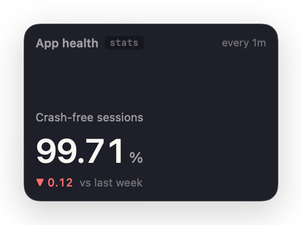
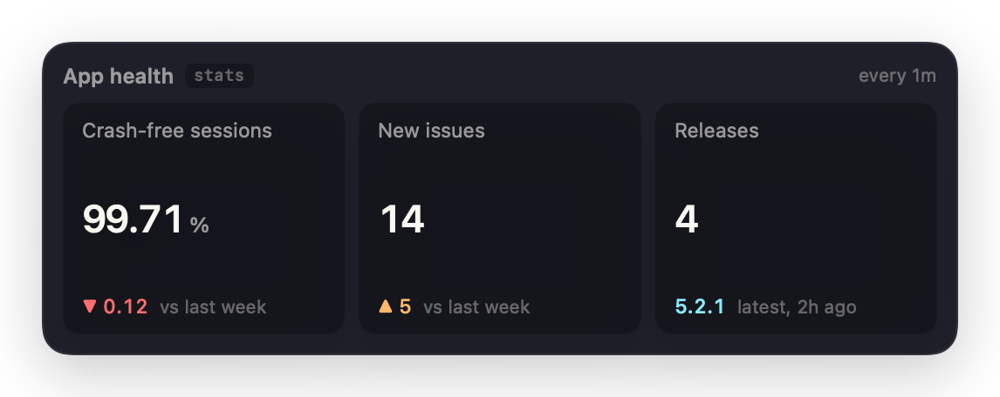
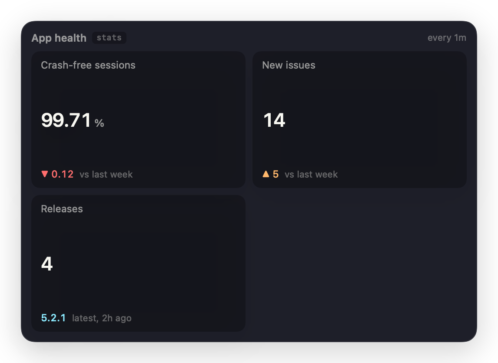

# Stats

A few numbers, each against its last period.

```json
{
  "stats": [
    { "label": "Crash-free sessions", "value": "99.71", "unit": "%", "delta": "▼ 0.12", "tone": "error", "vs": "vs last week" },
    { "label": "New issues", "value": 14, "delta": "▲ 5", "tone": "warning", "vs": "vs last week" },
    { "label": "Releases", "value": "4", "delta": "5.2.1", "tone": "info", "vs": "latest, 2h ago" }
  ]
}
```

  

| Size | Shows |
|---|---|
| `s` | The first stat, big: label, value, change. |
| `m` | The first three, in a row. |
| `l`, `xl` | The first six, in a 2×3 grid. |

## Fields

Each stat:

| Field | |
|---|---|
| `value` | Required. Text or a number. |
| `label` | Above the value. |
| `unit` | Smaller, after the value: `%`, `ms`, `pts`. |
| `delta` | The change, like `▲ 4` or `62%`. |
| `tone` | The delta's color. Your script decides, since up isn't always good. |
| `vs` | What the delta is against, like `vs last week`. |

`stats` can also be a single stat instead of an array.

`summary` and `menuBar` work as for [rows](../script-output.md#menu-bar): they set what the menu bar shows.

## Example

Open pull requests and reviews this week, with [gh](https://cli.github.com):

```sh
#!/bin/sh
open=$(gh search prs --author @me --state open --json number --jq length)
reviews=$(gh search prs --reviewed-by @me --updated ">=$(date -v-7d +%F)" --json number --jq length)
cat <<EOF
{ "stats": [
  { "label": "Open", "value": $open, "vs": "yours" },
  { "label": "Reviewed", "value": $reviews, "vs": "this week" }
] }
EOF
```

With `"type": "stats"` in [panel.jsonc](../panels.md), the tile always reads the output as stats, and says what's missing when the script prints something else.
