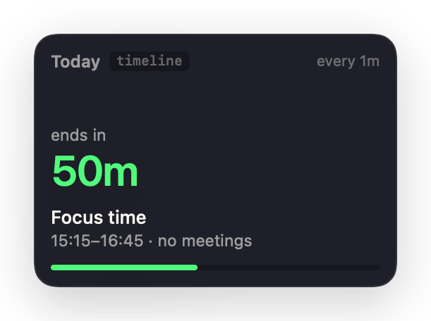
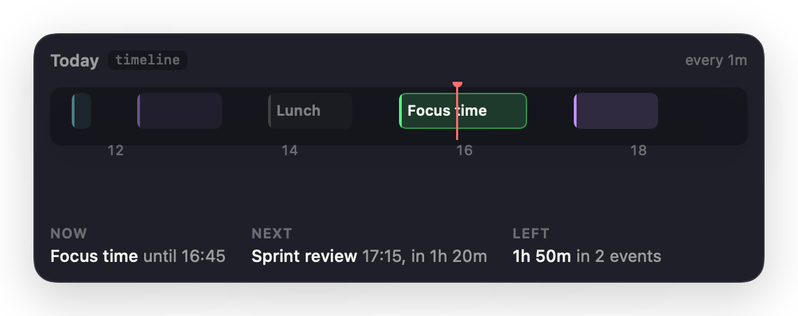
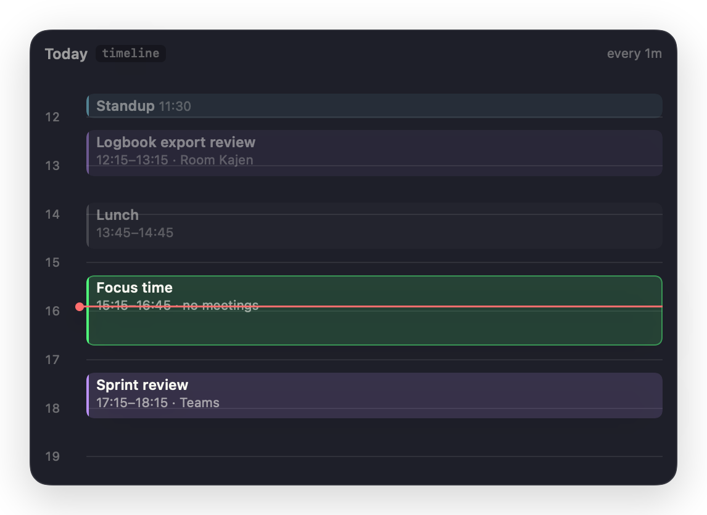

# Timeline

What's now, what's next, and how long until.

```json
{
  "timeline": {
    "from": "09:00",
    "to": "17:00",
    "events": [
      { "title": "Standup", "start": "2026-11-16T09:15", "end": "2026-11-16T09:30", "tone": "info" },
      { "title": "Logbook export review", "start": "2026-11-16T10:00", "end": "2026-11-16T11:00", "subtitle": "Room Kajen" },
      { "title": "Lunch", "start": "2026-11-16T11:30", "end": "2026-11-16T12:30", "tone": "muted" },
      { "title": "Focus time", "start": "2026-11-16T13:00", "end": "2026-11-16T14:30", "subtitle": "no meetings", "tone": "success" },
      { "title": "Sprint review", "start": "2026-11-16T15:00", "end": "2026-11-16T16:00", "subtitle": "Teams" }
    ]
  }
}
```

  

Tjuvkik draws now and counts down itself, every 30 seconds, so the tile stays right between runs. Your script only has to run when the events change.

| Size | Shows |
|---|---|
| `s` | A countdown: how long the current event has left, with a progress bar, or how long until the next one. |
| `m` | The window as a strip with a now line, then what's on now, what's next, and how much is left. |
| `l`, `xl` | An agenda: hour lines down the left, the events placed by time, and a now line. Events that overlap sit side by side. |

## Fields

| Field | |
|---|---|
| `events` | Required. The events, in any order. |
| `from` | Where the window starts, like `09:00`. |
| `to` | Where the window ends, like `17:00`. A `to` before `from` ends the next day. |

Without `from` and `to`, the window runs from the first event's hour to the last event's.

`timeline` can also be just the array of events.

Each event:

| Field | |
|---|---|
| `title` | Required. |
| `start` | Required. A time, see below. |
| `end` | A time. Without one, the event is a moment. |
| `subtitle` | After the time, like a room or `Teams`. |
| `tone` | The event's color. `accent` when not set. |
| `url` | Opened when the event is clicked in the glance. Closes the glance. |
| `command` | Run when the event is clicked in the glance, in the panel's folder. Wins over `url`. Keeps the glance open and runs the panel again, so the tile shows the result. |

## Times

| Written as | Means |
|---|---|
| `2026-11-16T15:00` | 15:00 on that day, in your Mac's time zone. Seconds are optional, and a space works instead of `T`. |
| `2026-11-16T14:00Z`, `2026-11-16T15:00+01:00` | That exact time, in any zone. |
| `2026-11-16` | Midnight at the start of that day. |
| `15:00` | 15:00 today. `24:00` is the end of today. |
| `9`, `17.5` | A number up to 24 is hours today: 09:00, 17:30. |
| `1794841200` | A larger number is Unix seconds, or milliseconds. |

Write times without a zone when they're local, like most calendars print them. Tjuvkik places them in the time zone your Mac is in when it draws them.

`summary` and `menuBar` work as for [rows](../script-output.md#menu-bar): they set what the menu bar shows.

## Example

Your day from a plain file next to the script, one event per line: start, end, title, separated by tabs.

```
09:15	09:30	Standup
13:00	14:30	Focus time
15:00	16:00	Sprint review
```

```sh
#!/bin/sh
awk -F '\t' '
  BEGIN { printf "{ \"timeline\": { \"from\": \"08:00\", \"to\": \"18:00\", \"events\": [" }
  NF >= 3 {
    gsub(/"/, "\\\"", $3)
    printf "%s{ \"title\": \"%s\", \"start\": \"%s\", \"end\": \"%s\" }", sep, $3, $1, $2
    sep = ", "
  }
  END { print "] } }" }' today.tsv
```

Times without a date are today's, so the same file works every day.

With `"type": "timeline"` in [panel.jsonc](../panels.md), the tile always reads the output as a timeline, and says what's missing when the script prints something else.
